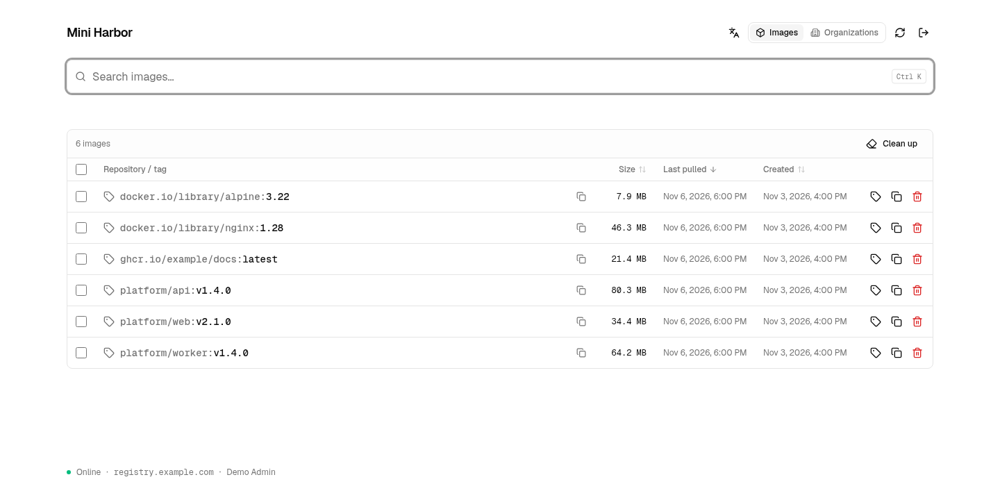

# Mini Harbor

**A lightweight container registry with a web UI and pull-through cache.**

Store, browse, and cache container images on your homelab or small-team server. Standard Docker push/pull, a compact Go backend, and SQLite — no separate database server or Redis.



*Actual console rendered with example data.*

## Why Mini Harbor?

- **Small footprint:** 52.3 MiB average memory across all three application containers in an observed k3s deployment. See [resource usage](docs/resource-usage.md) for measurement scope and Harbor sizing context.
- **Easy to run:** three containers, Docker Compose, persistent data volumes.
- **Image management:** inspect manifests and platforms, copy pull commands, manage tags, and preview stale-image cleanup.
- **Pull-through caching:** Docker Hub, GHCR, configurable upstream priorities, and fallback.
- **Simple access:** optional OIDC login and group restrictions for management, with anonymous browsing.
- **English and Chinese UI:** organization filters and a familiar Docker workflow.

## Deploy with Docker Compose

The public image **`ghcr.io/fanyang89/mini-harbor:latest`** supports Linux **amd64** and **arm64**. No registry login, Go, Node.js, or local image build is required.

For a quick trial, install Git, Docker, and Docker Compose, then run the commands below. For a registry shared with other machines, use [LAN deployment](#lan-deployment) instead.

```bash
git clone --depth 1 https://github.com/fanyang89/mini-harbor.git
cd mini-harbor
docker compose pull
docker compose up -d --no-build
```

Open http://localhost:8080. The stack runs the registry, cache gateway, and web console, with data stored in persistent Docker volumes.

Push your first image:

```bash
docker pull hello-world
docker tag hello-world localhost:5000/hello-world:latest
docker push localhost:5000/hello-world:latest
```

The defaults are for a trusted local network. Before exposing the service, configure [authentication and network access](docs/authentication.md).

`latest` follows tested builds of `main`. For a fixed version, set `MINI_HARBOR_IMAGE` in `.env` to a `ghcr.io/fanyang89/mini-harbor:sha-<full-commit-sha>` tag or image digest. See [getting started](docs/getting-started.md) for port settings and [operations](docs/operations.md) for updates.

## LAN deployment

Choose a route before starting the stack. The supplied overrides require **Docker Compose 2.24.4+** and bind only to the server's specified LAN address.

| Your setup | Deployment | Client setup |
| --- | --- | --- |
| Own a domain | [Trusted HTTPS with DNS-01](docs/private-registry-domain.md) | Internal DNS or hosts; no custom CA. Includes a Cloudflare-enabled Caddy build. |
| No domain — recommended | [HTTPS with Caddy's internal CA](docs/private-registry-ca.md) | Internal DNS or hosts, then install the CA certificate |
| Quick trusted-LAN setup | [HTTP by IP address](docs/private-registry-http.md) | Add the exact `IP:port` to Docker's `insecure-registries` |

### Example: HTTPS without a domain

Clone the repository as above. In its root directory, merge these settings into `.env`, replacing the example IP with the server's LAN address:

```dotenv
LAN_IP=192.168.1.20
REGISTRY_HOST=registry.home.arpa
CADDY_IMAGE=caddy:2-alpine
CADDY_CONFIG=./docs/examples/lan/Caddyfile.internal
```

Set `REGISTRY_HTTP_SECRET` to a value generated with `openssl rand -hex 32`, then start the published images and Caddy:

```bash
docker compose -f compose.yml -f docs/examples/lan/compose.https.yml pull
docker compose -f compose.yml -f docs/examples/lan/compose.https.yml up -d --no-build
```

On each client, resolve `registry.home.arpa` to the server using internal DNS or a hosts entry:

```text
192.168.1.20 registry.home.arpa
```

**Before browsing or pushing, [export and trust the CA certificate](docs/private-registry-ca.md#2-start-and-export-the-ca-certificate).** A hosts entry alone does not make HTTPS trusted. Then open https://registry.home.arpa and push images as `registry.home.arpa/demo/hello-world:latest`.

The HTTPS override exposes only TCP 443; ports 5000 and 8080 stay inside the container network. Keep using both `-f` arguments for future operations. Restrict access to trusted LAN clients and do not forward these ports from the internet. HTTPS does not add Registry authentication; web OIDC does not protect Docker push/pull. See the [network setup and verification guide](docs/private-registry.md).

## Documentation

| Guide | What it covers |
| --- | --- |
| [Getting started](docs/getting-started.md) | Installation, first push, hostnames, and ports |
| [Internal-only deployment](docs/private-registry.md) | LAN networking, HTTPS with or without a domain, and HTTP fallback |
| [Using the console](docs/usage.md) | Image details, tags, organizations, and screenshots |
| [Proxy caching](docs/proxy-cache.md) | Upstreams, fallback, credentials, and outbound proxies |
| [Configuration](docs/configuration.md) | Environment variables and persistent storage |
| [Authentication](docs/authentication.md) | OIDC, group restrictions, and Registry access |
| [Operations](docs/operations.md) | Updates, backups, garbage collection, and metrics |
| [Resource usage](docs/resource-usage.md) | Observed footprint and comparison with Harbor |
| [Development](docs/development.md) | Local development and checks |

Mini Harbor is an independent project, not an official Harbor distribution. It focuses on image storage, browsing, and caching; it does not include project-level RBAC, vulnerability scanning, or replication policies.

## License

MIT. See [LICENSE](LICENSE).
