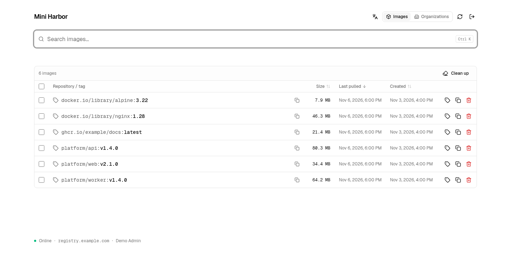
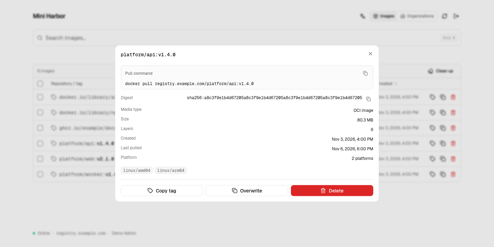

# Using the console

[Home](../README.md) · [Getting started](getting-started.md)

## Browse images

The image catalog shows repository names, tags, sizes, creation times, and last-pulled times. Search by image name, filter by organization, and sort by size or timestamps. Copy a pull command directly from the table or open an image for details.

The image catalog loads 50 matching images at a time. **Load more** fetches the
next page; it does not automatically download the full catalog. Search and
sorting run on the server and cover all repositories, including images that
have not been loaded in the browser. A search ending in `/` selects that
repository prefix. Changing search or sort resets pagination; refreshing starts
a new load. Select-all applies only to displayed rows.

Switching to Organizations cancels unfinished image requests and loads only
organization data. Management queries and writes use [GraphQL](graphql.md).
Docker/OCI clients continue to use the standard Registry `/v2/` API.



## Inspect an image

Select an image to see its digest, media type, layers, and platforms, along with a ready-to-run pull command.



Both screenshots show the actual UI rendered locally with example data, not a production registry.

## Manage tags and images

- **Copy tag:** create a new tag from an existing manifest in the same repository.
- **Overwrite:** replace an existing tag with another manifest.
- **Delete a tag:** remove only that reference.
- **Delete a manifest:** remove the manifest and every tag that points to its digest.
- **Clean up:** preview images unused for the selected period before confirming deletion.

Upload new image content with `docker push`. Deleting references does not immediately free all blob storage; see [garbage collection](operations.md#registry-garbage-collection).

Successful manifest `GET` and `HEAD` requests through the gateway update the last-pulled timestamp. Requests that bypass the gateway do not update it.

## Organizations

Use organizations to group repositories in the console. A repository belongs to an organization when its name starts with `org-name/`:

```bash
docker tag hello-world localhost:5000/platform/hello-world:latest
docker push localhost:5000/platform/hello-world:latest
```

Create and edit organizations in the Organizations view. Names are immutable, and an organization can only be deleted after every repository under its namespace has been removed. Organizations group images; they do not provide per-organization access control.

## Language and sign-in

Use the language control to switch between English and Chinese. With OIDC enabled, the catalog remains publicly readable while management actions require sign-in and any configured group membership. See [authentication](authentication.md).
